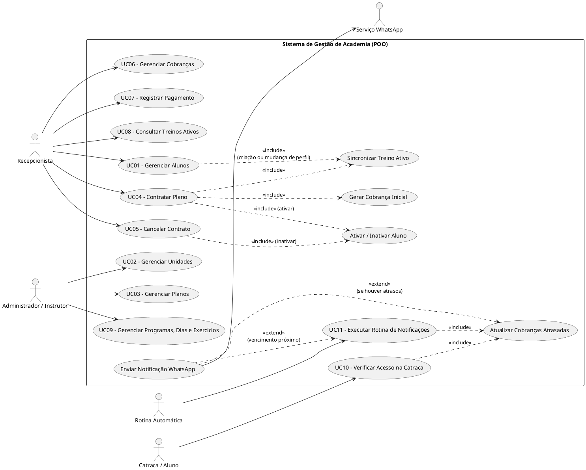
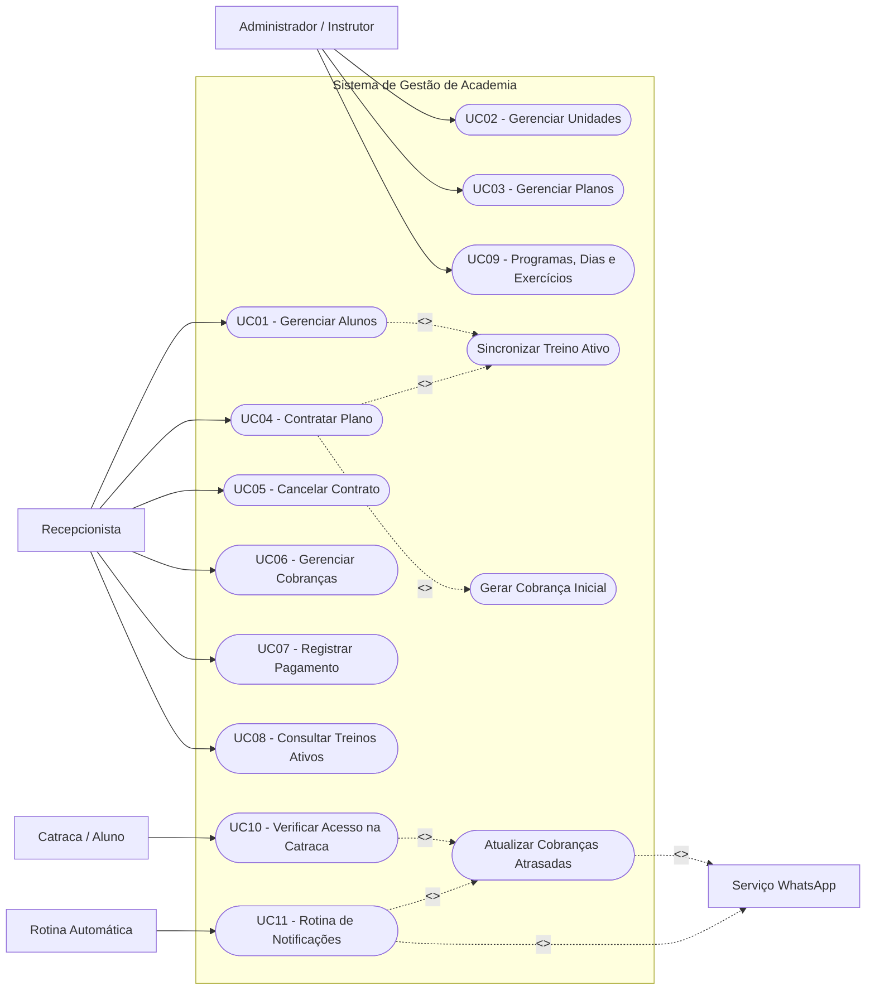

# Diagrama de Casos de Uso — Sistema de Gestão de Academia

Este documento apresenta os atores, os casos de uso e suas relações (`<<include>>` e `<<extend>>`) extraídos fielmente da lógica do projeto POO em `POO/src/`.

## 1. Atores Identificados

| Ator | Tipo | Responsabilidade Principal |
| :--- | :--- | :--- |
| **Recepcionista / Atendente** | Primário | Cadastra e atualiza alunos, contrata e cancela planos, registra pagamentos e consulta treinos ativos. |
| **Administrador / Instrutor** | Primário | Mantém unidades, planos, programas de treino, dias de treino, exercícios e vínculos de exercícios por dia. |
| **Catraca / Aluno** | Primário | Solicita liberação de entrada na academia informando o identificador do aluno. |
| **Rotina Automática (Agendador)** | Primário (Temporal) | Dispara periodicamente a verificação de cobranças próximas do vencimento e em atraso (`notificacoesAutomaticas`). |
| **Serviço WhatsApp** | Secundário (Sistema Externo) | Recebe os disparos de notificação de vencimento próximo e cobrança atrasada (`NotificacaoService`). |

---

## 2. Diagrama em PlantUML (Notação UML Padrão)

---

## 3. Visão Rápida em Mermaid

---

## 4. Resumo dos Principais Casos de Uso e Regras

| Código | Caso de Uso | Regras / Fluxos Principais | Exceções Previstas |
| :--- | :--- | :--- | :--- |
| **UC01** | Gerenciar Alunos | Valida dados obrigatórios, CPF/e-mail únicos; na criação e na mudança de nível/frequência, sincroniza `TreinoAtivo`. | `ValidacaoException`, `RegraDeNegocioException`, `RecursoNaoEncontradoException` |
| **UC02** | Gerenciar Unidades | CRUD de unidade física com unicidade de CNPJ. | `ValidacaoException`, `RegraDeNegocioException`, `RecursoNaoEncontradoException` |
| **UC03** | Gerenciar Planos | CRUD de planos com tipo único e exigência de desconto progressivo (> 0) para `TRIMESTRAL`, `SEMESTRAL` e `ANUAL`. | `ValidacaoException`, `RegraDeNegocioException`, `RecursoNaoEncontradoException` |
| **UC04** | Contratar Plano | Garante no máximo 1 contrato `ATIVO` por aluno, calcula `dataTermino = dataInicio + duracao`, gera cobrança `PENDENTE`, ativa o aluno e sincroniza treino. | `RegraDeNegocioException`, `RecursoNaoEncontradoException`, `ValidacaoException` |
| **UC05** | Cancelar Contrato | Marca contrato como `CANCELADO` e inativa o aluno vinculado. | `RegraDeNegocioException` (já cancelado), `RecursoNaoEncontradoException` |
| **UC06/07** | Cobranças e Pagamento | Valor sempre derivado do `Plano` do contrato; pagamento exige data válida (passado/presente) e forma de pagamento, impedindo pagamento duplicado. | `RegraDeNegocioException`, `ValidacaoException`, `RecursoNaoEncontradoException` |
| **UC10** | Verificar Acesso | Atualiza cobranças vencidas há mais de 2 dias (`ATRASADO`); exige aluno `ATIVO`, contrato `ATIVO` e ausência de cobrança `ATRASADO`. | `RegraDeNegocioException` (aluno inativo), `RecursoNaoEncontradoException` |
| **UC11** | Rotina de Notificações | Notifica cobranças `PENDENTE` com vencimento entre hoje e `hoje + 2` e atualiza cobranças atrasadas. | — |
