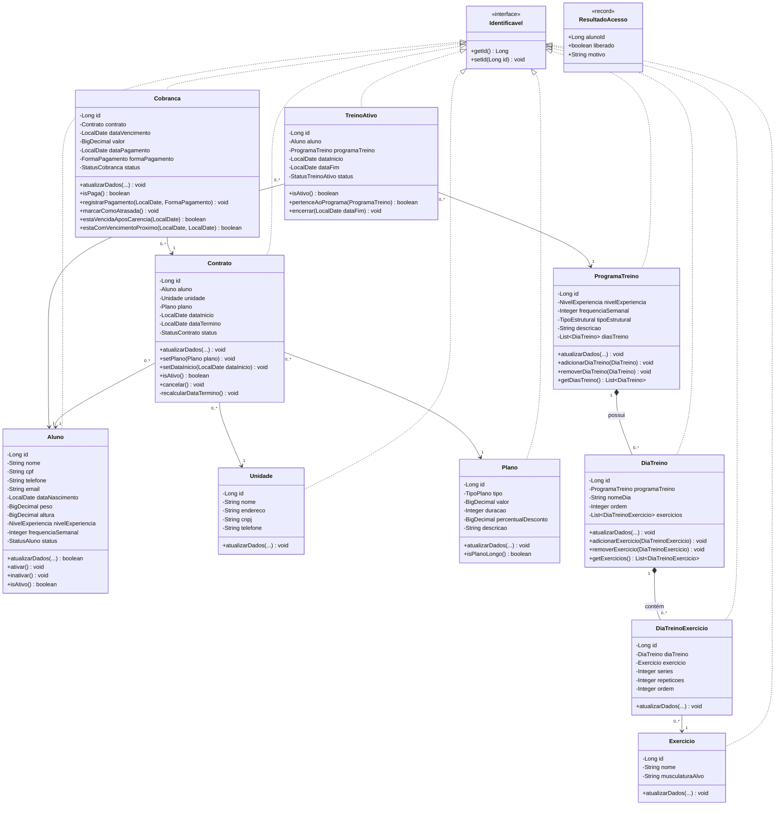
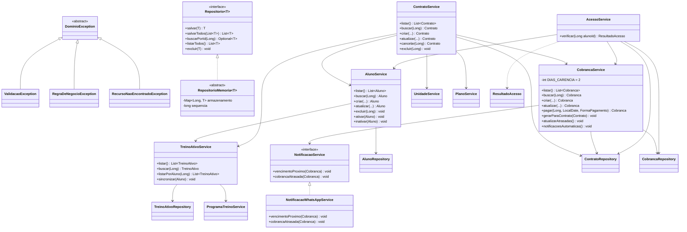

# Diagrama de Classes — Sistema de Gestão de Academia (POO)

Os diagramas abaixo refletem **1:1** as classes, interfaces, enumerações, atributos, métodos e multiplicidades implementadas em `POO/src/`.

## 1. Diagrama de Domínio e Enumerações (Mermaid)



---

## 2. Diagrama da Camada de Serviços, Repositórios e Exceções (Mermaid)



---

## 3. Versão Completa em PlantUML (Domínio + Serviços)

```plantuml
@startuml
skinparam classAttributeIconSize 0

package "enums" {
  enum StatusAluno { ATIVO; INATIVO }
  enum StatusContrato { ATIVO; CANCELADO }
  enum StatusCobranca { PENDENTE; PAGO; ATRASADO }
  enum StatusTreinoAtivo { ATIVO; ENCERRADO }
  enum FormaPagamento { PIX; CARTAO_CREDITO; CARTAO_DEBITO; DINHEIRO }
  enum NivelExperiencia { INICIANTE; INTERMEDIARIO; AVANCADO }
  enum TipoEstrutural { FULLBODY; UPPER_LOWER; PPL_UPPER_LOWER; PPL_2X }
  enum TipoPlano { DIARIO; MENSAL; TRIMESTRAL; SEMESTRAL; ANUAL }
}

package "model" {
  interface Identificavel {
    + getId() : Long
    + setId(id : Long) : void
  }

  class Aluno {
    - id : Long
    - nome : String
    - cpf : String
    - telefone : String
    - email : String
    - dataNascimento : LocalDate
    - peso : BigDecimal
    - altura : BigDecimal
    - nivelExperiencia : NivelExperiencia
    - frequenciaSemanal : Integer
    - status : StatusAluno
    + atualizarDados(...) : boolean
    + ativar() : void
    + inativar() : void
    + isAtivo() : boolean
  }

  class Unidade {
    - id : Long
    - nome : String
    - endereco : String
    - cnpj : String
    - telefone : String
    + atualizarDados(...) : void
  }

  class Plano {
    - id : Long
    - tipo : TipoPlano
    - valor : BigDecimal
    - duracao : Integer
    - percentualDesconto : BigDecimal
    - descricao : String
    + atualizarDados(...) : void
    + isPlanoLongo() : boolean
  }

  class Contrato {
    - id : Long
    - dataInicio : LocalDate
    - dataTermino : LocalDate
    - status : StatusContrato
    + isAtivo() : boolean
    + cancelar() : void
    - recalcularDataTermino() : void
  }

  class Cobranca {
    - id : Long
    - dataVencimento : LocalDate
    - valor : BigDecimal
    - dataPagamento : LocalDate
    - formaPagamento : FormaPagamento
    - status : StatusCobranca
    + isPaga() : boolean
    + registrarPagamento(data : LocalDate, forma : FormaPagamento) : void
    + marcarComoAtrasada() : void
  }

  class ProgramaTreino {
    - id : Long
    - nivelExperiencia : NivelExperiencia
    - frequenciaSemanal : Integer
    - tipoEstrutural : TipoEstrutural
    - descricao : String
    + getDiasTreino() : List<DiaTreino>
  }

  class DiaTreino {
    - id : Long
    - nomeDia : String
    - ordem : Integer
    + getExercicios() : List<DiaTreinoExercicio>
  }

  class Exercicio {
    - id : Long
    - nome : String
    - musculaturaAlvo : String
  }

  class DiaTreinoExercicio {
    - id : Long
    - series : Integer
    - repeticoes : Integer
    - ordem : Integer
  }

  class TreinoAtivo {
    - id : Long
    - dataInicio : LocalDate
    - dataFim : LocalDate
    - status : StatusTreinoAtivo
    + isAtivo() : boolean
    + encerrar(dataFim : LocalDate) : void
  }

  class ResultadoAcesso <<record>> {
    + alunoId : Long
    + liberado : boolean
    + motivo : String
  }
}

Contrato "0..*" --> "1" Aluno
Contrato "0..*" --> "1" Unidade
Contrato "0..*" --> "1" Plano
Cobranca "0..*" --> "1" Contrato
TreinoAtivo "0..*" --> "1" Aluno
TreinoAtivo "0..*" --> "1" ProgramaTreino
ProgramaTreino "1" *-- "0..*" DiaTreino
DiaTreino "1" *-- "0..*" DiaTreinoExercicio
DiaTreinoExercicio "0..*" --> "1" Exercicio
@enduml
```
