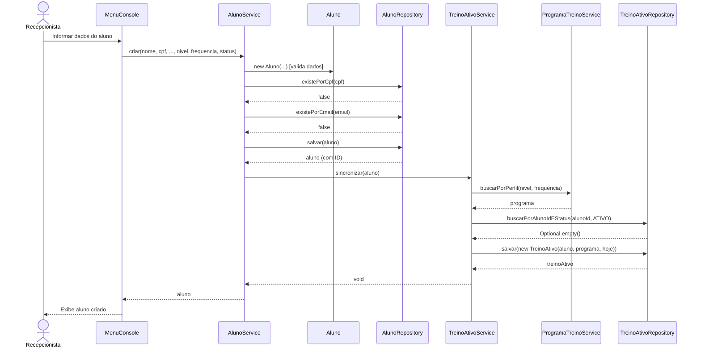
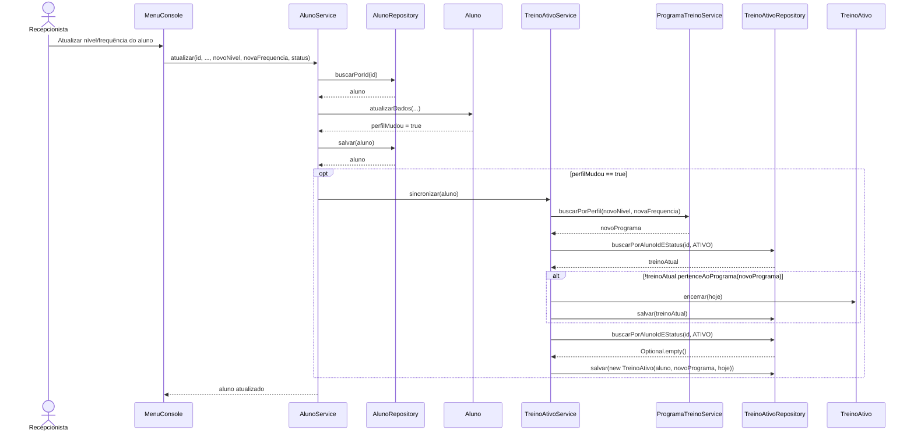
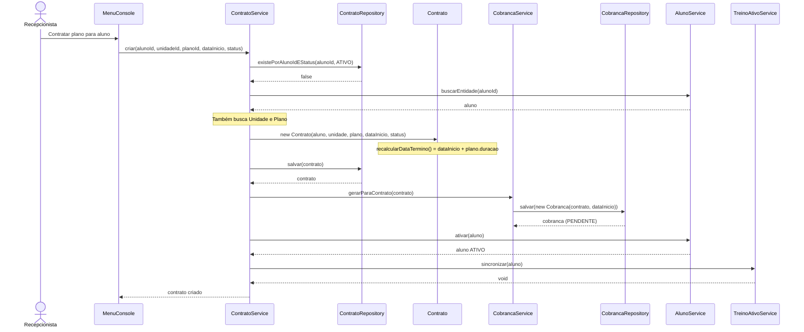
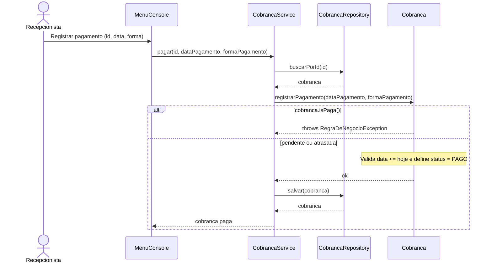
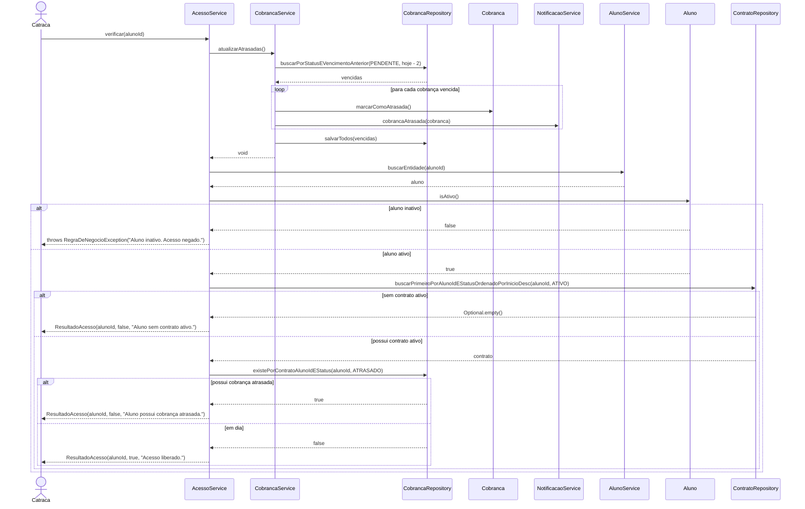
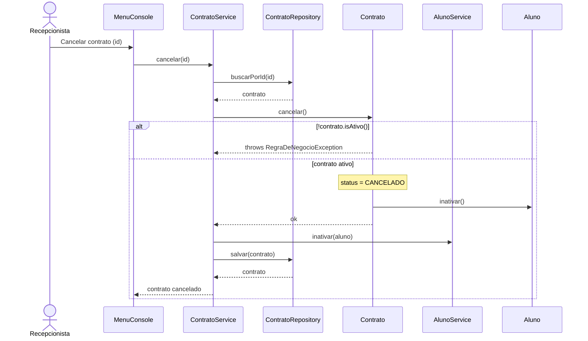

# Diagramas de Sequência — Sistema de Gestão de Academia (POO)

Abaixo estão os 6 principais fluxos de sequência alinhados diretamente aos métodos e interações entre objetos implementados em `POO/src/`.

---

## 1. Cadastrar Aluno e Gerar Treino Ativo

---

## 2. Atualizar Perfil do Aluno e Resincronizar Treino

---

## 3. Contratar Plano (com Cobrança, Ativação e Treino)

---

## 4. Registrar Pagamento de Cobrança

---

## 5. Verificar Acesso na Catraca

---

## 6. Cancelar Contrato e Inativar Aluno

